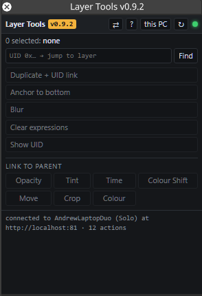

# Layer Tools

A disguise Designer plugin: a list of one-click actions applied to the layers selected in the timeline.

> **Beta — use at your own risk.** Layer Tools edits your project from Designer's Python API. Save your
> project before using it, and test it on a copy before using it on a show file.



## Features
- **Duplicate + UID link** — copies a layer and links every number field to the original by UID, so the copy
  follows it.
- **Link to parent** — select several layers; the first is the parent and the rest follow its Opacity, Tint,
  Time, Colour Shift, Move, Crop or Colour fields.
- **Blur** — adds a blur layer fed from a Video layer, matching its blend mode, mapping and opacity, and sets
  the source to Alpha.
- **Anchor to bottom** — puts an expression on position y that keeps the layer at the bottom.
- **Clear expressions** — resets every expression on a layer back to `self`.
- **Show UID** / **Find by UID** — shows a layer's UID, or jumps the playhead to the layer with a given UID.
- **Check arrows** — read-only list of broken or duplicated arrows on the current track.
- **This PC / director** — works from an editor machine using that machine's own selection.

## Use
Open **Layer Tools** from Designer's plugin menu, select one or more layers, click an action (hover for what it does).
The log at the bottom reports per layer what happened. **↻** re-reads `__init__.py`, so you can edit
actions without restarting Designer. **?** dumps the selected layer's field names.

## Design rules
- **Arrows:** `track.makeArrow` only accepts Modules ("Cannot convert from 'Layer' to 'Module'"), and the only
  way to get one is `PlayHead.getModuleForLayer`. Only the **Blur** button makes arrows: Video layer to its
  own blur only, transport stopped, one attempt, checked. Drawing the arrow by hand always works.
- One attempt per edit. If an edit can't be verified it's reported, never retried another way.
- Blur never makes a second blur layer for a layer that already has one; clicking again only finishes the
  missing steps.
- Duplicate and Blur skip layers that aren't directly on the current track (inside a group,
  other track).
- Problems that used to be swallowed show in the log as `!` warnings; a layer with any failure shows ✗.
- **⇄ Check arrows** (header) is read-only: lists arrows on the current track that are invalid, duplicated,
  or point at something that isn't a layer on that track. It changes nothing.
- The window only asks Designer for the selection every 2 s, and pauses after 30 s without mouse or keyboard
  use in the window (the selection line dims). Each check runs Python on Designer's main thread.

## Director or editor
The **this PC** / **director** button in the header picks which Designer the window talks to.
**this PC** (default) uses `http://localhost` (ports 80, 81, 8080), the Designer on the machine the window is open on, so
on an editor it reads that editor's selection. **director** uses the address Designer passes in
`?director=`. Hover the green dot to see which machine and role answered; if this PC's API can't be
reached, the window falls back to the director and says so in the log.

## Find a layer by UID
Type or paste a UID in the box (`0x1a2b…`, a plain number, or a whole `getByUID(0x…).field` expression)
and press **Find** or Enter. It finds the layer on any track (including inside groups), switches to that
track if needed and moves the playhead to the layer's start, stopped. Designer doesn't let plugins select
layers, so the log names the layer rather than highlighting it. Uses `/api/session/transport/gototrack` and
`gototime` on the active transport.

## Actions
| Action | What it does |
|---|---|
| Duplicate + UID link | Makes a new layer of the same type, start and length named `<name> link` (Designer's own duplicate call is blocked for plugins), then puts `getByUID(0x<uid>).<field>` on every number field of the copy (media, mapping and text fields get every keyframe copied instead, see `LINK_SEQ_TYPES`). Fields Designer rejects are reset to `self` and listed in the log. |
| Anchor to bottom | Puts `(1 - module:this.size) / 2` on the position y field (`ANCHOR_BOTTOM_EXPR`, field names tried: `POS_Y_FIELDS`). |
| Blur | Select a Video layer (or its blur layer) with playback **stopped** and click. Makes `<name> blur` over the same time with the layer's blend mode and mapping and its opacity (`brightness`) set to `getByUID(0x<uid>).brightness`, makes the arrow from the layer into it, then sets the layer to Alpha. Everything is checked before anything is made. If it stops part way (e.g. Designer has no module for the new layer yet) it says why; click **Blur** again to finish. Clicking it on a finished pair changes nothing. |
| Clear expressions | Sets every expression-controlled field back to `self`. |
| Show UID | Prints the layer's UID in hex. |

## Link to parent
Buttons at the bottom of the list, under **Link to parent**. Select 2+ layers: the first (marked ★) is the
parent; every other selected layer gets each field in that section set to `getByUID(0x<parent>).<field>`.
Only number fields are linked (Designer can't evaluate an expression on a media/resource field); others are
skipped and named in the log. Fields are in `LINK_GROUPS`:

| Button | Fields |
|---|---|
| Opacity | brightness |
| Tint | xCol, yCol, tint.r/g/b/a |
| Time | speed, mode, at end point (loop), transition time |
| Colour Shift | brightness (shift), contrast (scale), saturation scale, hue shift, RGB controlled, red/green/blue min, max, gamma, and any field whose name contains "gain" |
| Move | size, scale.x/y, pos.x/y, rotation |
| Crop | left, right, top, bottom, cropSoftness |
| Colour | acesExposure, acesGamma, cdl, ocioExposure, ocioContrast, ocioGamma |

To add a section, add a line to `LINK_GROUPS`; the button appears in that grid. An entry like `'*gain'` matches every field whose
name contains `gain` (used when a field's exact name varies); the log names what it linked.

## Adding an action
In `__init__.py`, under `# --- actions`:

```python
@action('my_thing', 'My thing', 'One-line description shown in the window.')
def _my_thing(layer, track):
    fs = layer.findSequence('brightness')
    fs.setExpression(u'self * 0.5')
    return {'note': 'halved'}
```

Return a dict (`note` shows in the log); `raise Problem('...')` to report a failure. Never `raise Exception(...)`:
`from d3 import *` replaces `Exception` with d3's own class, which fails with "Can't construct Exception(str)".

For an action that needs all the selected layers at once (in selection order), use
`@action(..., multi=True, min_layers=2)` (add `group='Link to parent'` to put it in that grid); the function gets `(layers, track)` and returns a list of
dicts, one per layer, each with a `layer` key. The button stays disabled until enough layers are selected. Press **Reload**. Keep it Python 2.7
(no f-strings) and don't `import sys`/`traceback` (Designer blocks them).

## Tuning
- `LINK_EXPR` — the link expression form. If Designer wants a different UID syntax, change this one line.
- `LINK_SKIP` — internal field names never linked.
- `LINK_SEQ_TYPES` — which field kinds get linked. Default `FloatSequence` only: Designer can't evaluate an expression on a resource field (video, mapping) and reports "Bad dynamic_cast".
- `NAME_LINK_EXPR` — used instead of `LINK_EXPR` for fields whose name starts with a digit (`1st brightness`):
  Designer rejects `getByUID(0x…).1st_brightness` ("UnexpectedToken") but accepts
  `module:Gradient.1st_brightness`. Those links follow the layer **name**, so they break if it's renamed; the
  log lists them, and warns if another layer on the track has the same name.
- `EXPR_UNDERSCORE` — characters in a field name written as `_` in the expression (space and brackets: `scale (x)` → `scale__x_`).
- `LINK_SUFFIX` — name suffix for the duplicate.
- `LINK_GROUPS` — the Link to parent buttons and their fields.
- `BLUR_SUFFIX`, `BLEND_ALPHA` (1 = Alpha), `OPACITY_FIELD`, `VIDEO_CLASSES` — Blur settings.
